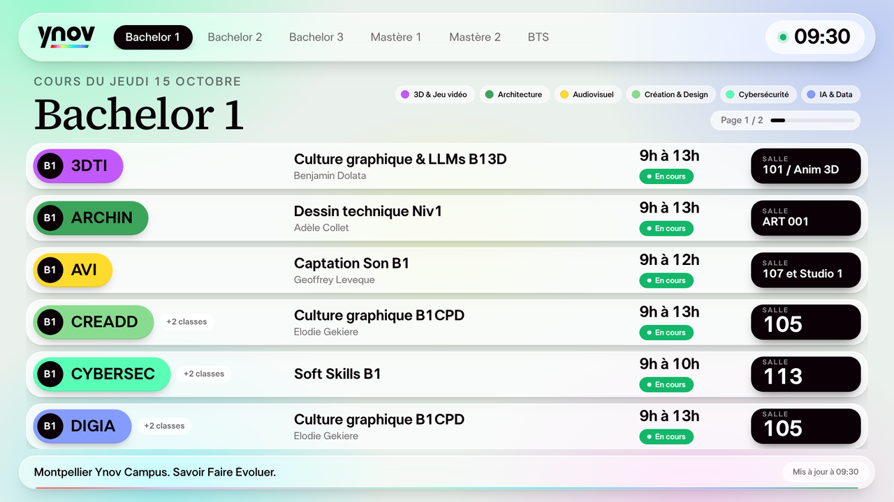

# Planning Ynov - cours du jour sur les TV

Projet perso fait à Ynov Montpellier. Sur les écrans du campus, le planning était un gros tableau que
personne n'arrivait à lire : les étudiants passaient leur temps à chercher leur salle. Du coup j'ai fait
une page plus lisible, branchée sur HyperPlanning, qu'on peut mettre dans Emity (le logiciel des TV).



## Ce que ça fait

- une page par niveau (B1, B2, B3, M1, M2, BTS) qui tournent toutes seules
- une ligne par classe, avec la couleur de la filière, le cours, le prof, l'horaire et la salle
- "En cours", "Modifié" et "Annulé" bien visibles
- un back-office (mot de passe) pour la péda : connexion à HyperPlanning, écrans, bandeau d'annonce
- marche aussi en vertical, et garde les dernières données si le réseau coupe

Le planning est relu toutes les 2 minutes et les écrans se mettent à jour toutes les 30 s,
donc un changement fait par la péda dans HyperPlanning apparaît en 2-3 minutes.

## Stack

- Node.js / Express pour le serveur (`server.js`, `src/`)
- une version PHP de la même chose (`php/`) parce que l'hébergement IONOS ne fait pas tourner Node
- HTML/CSS/JS sans framework pour l'écran : les navigateurs des TV sont vieux, donc ES5 et pas de CSS grid
- charte reprise de ynov.com (polices LT Superior, couleurs des filières)

## Lancer en local

```bash
npm install
cp .env.example .env
npm run hash-password      # copier le hash dans ADMIN_PASSWORD_HASH (entre guillemets simples)
openssl rand -hex 32       # pour SESSION_SECRET, puis encore une fois pour SECRETS_KEY
npm start
```

`SESSION_SECRET` est obligatoire sinon le serveur refuse de démarrer. En local sans HTTPS il faut aussi
mettre `COOKIE_SECURE=false` dans le `.env`. `npm run dev` relance le serveur à chaque modif.

- écran : http://localhost:3000/ecran/general
- admin : http://localhost:3000/admin

Sans connexion HyperPlanning l'appli tourne en mode démo avec des vrais cours de Montpellier.

## Brancher HyperPlanning

Dans l'admin, onglet Connexion. Il faut demander à l'admin HyperPlanning un compte "Service Web"
en lecture seule. Trois façons de récupérer les cours :

1. **API REST** (`.../hpsw/api/v1/`) : la plus simple, basée sur la [spec officielle](https://www.index-education.com/FichiersExternes/campus/2026/fr/OpenAPIRestPC.yaml)
2. **Service Web SOAP** (`.../hpsw/wsdl/RpcEncoded`) : pour les versions plus anciennes. Les noms des
   opérations changent selon les versions, donc le connecteur essaie plusieurs noms (`php/lib/soap.php`).
   Le bouton Tester affiche ce qu'il a trouvé ou pas.
3. **Liens iCal** des promotions : en dépannage, un lien par classe.

Le mot de passe du Service Web est chiffré (AES-256-GCM) et n'est jamais envoyé aux écrans.

## Mettre en ligne sur IONOS

1. copier `php/config.sample.php` en `php/config.php` et le remplir (hash du mot de passe, clés)
2. `npm run build:php` -> ça crée `dist/ionos/`
3. envoyer tout le contenu de `dist/ionos/` sur un sous-domaine (PHP 8.2 minimum, SSL activé)
4. vérifier que `/healthz` répond `{"ok":true}` et que `/config.php` est bien bloqué

Pour une mise à jour : refaire le build et renvoyer les fichiers sans toucher au dossier `data/`.

Sinon avec Docker : remplir le `.env` puis `docker compose up -d`. Il y a aussi une config `render.yaml`
et des exemples nginx/systemd dans `deploy/`.

## Mettre l'écran dans Emity

Dans l'admin, onglet Écrans, "Copier l'URL", puis dans Emity : widget Site web en plein écran.
On peut créer plusieurs écrans (par ex. un écran à l'étage 3 avec seulement les M1/M2).
Pense à mettre une clé d'écran (`DISPLAY_KEY` dans le `.env`, ou `display_key` dans `php/config.php`)
pour que le planning ne soit pas public.

## Organisation du code

```
server.js              routes (écrans, API, admin) + sécurité
src/schedule.js        synchro HyperPlanning, fusion des doublons, détection des modifs
src/normalize.js       niveau, filière, couleur, salle
src/sources/           connecteurs (REST, SOAP, iCal, démo)
php/                   la même chose en PHP pour IONOS
public/display/        l'écran TV
public/admin/          le back-office
```

## Sécurité

Mot de passe en bcrypt, session HttpOnly/SameSite, max 8 essais de connexion par 15 min, token CSRF,
CSP stricte, admin filtrable par IP (`ADMIN_ALLOWED_IPS`). Les écrans sont en lecture seule.

## À faire

- tester le connecteur SOAP sur le vrai serveur HyperPlanning
- ajouter la police LT Superior Serif pour les titres (pour l'instant c'est Source Serif)

## Licence

Code perso, pas de licence open source pour l'instant. La police LT Superior (celle de ynov.com) est sous
licence SIL OFL, voir `public/assets/fonts/lt-superior/OFL.txt`. Le logo et la charte appartiennent à Ynov.
